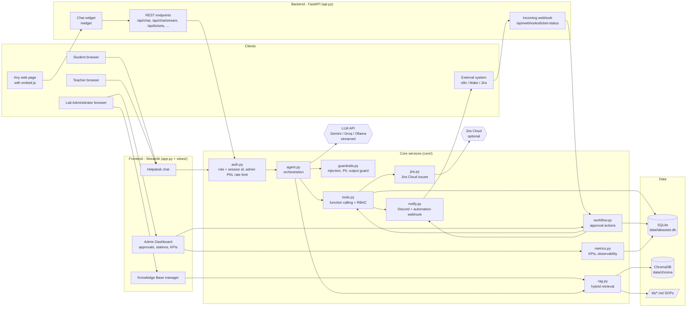
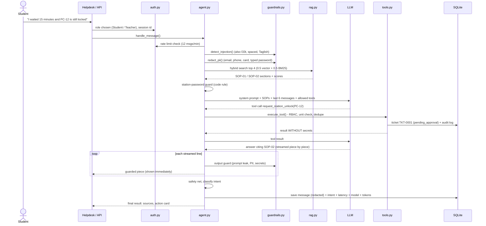
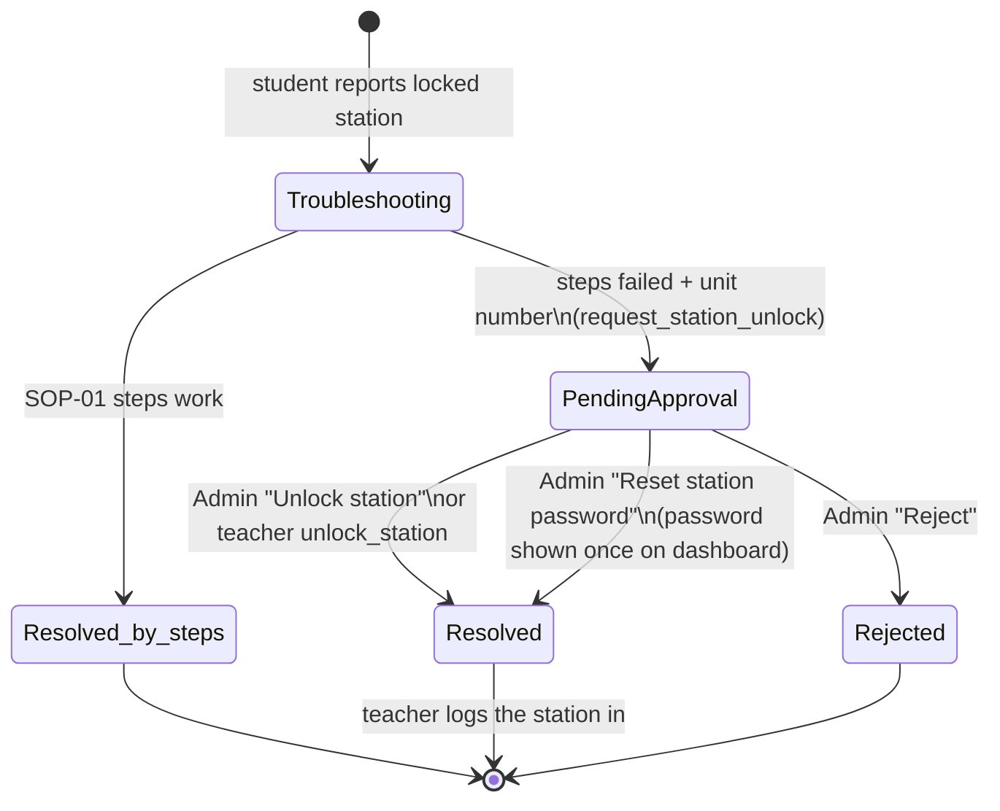
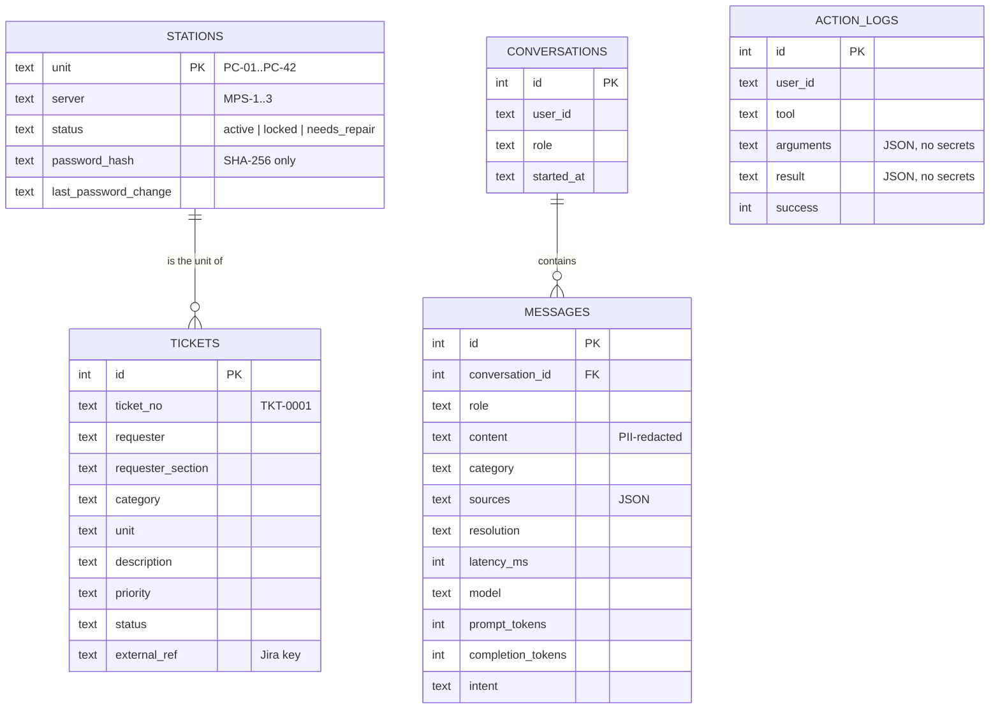

# LabAssist - Technical Architecture

LabAssist is a first-level IT helpdesk for the CSIS ICT Laboratory (42 thin clients on three
Windows MultiPoint Servers). It combines retrieval-augmented generation (RAG) over the lab's
Standard Operating Procedures with LLM function calling, a human-in-the-loop approval step,
guardrails and an observability dashboard.

> Diagrams use Mermaid. They render on GitHub, in VS Code (Markdown Preview Mermaid Support) and at
> <https://mermaid.live> (paste the code to export a PNG for the presentation deck).

## 1. Component diagram

Both the Streamlit pages and the REST API call the same `core/` services, so every rule
(guardrails, RBAC, rate limits, audit log) is enforced identically on both channels.

## 2. Message pipeline (sequence)

If there is no API key or every model fails (429 quota, 404, timeout), `agent.py` switches to the
**offline rules** (same tools, best SOP section) so the helpdesk never stops.

## 3. Unlock request workflow (state diagram)

## 4. Database schema (ER diagram)

There are no user or student tables: nobody has a personal account. A ticket stores the
requester as a session id ("STUDENT-3f9a2c1b", "TEACHER-...") or "ADMIN".

## 5. RAG design

| Step | Implementation |
|---|---|
| Knowledge base | 16 SOP markdown files in `kb/` (title, applies to, common phrases in English + Taglish, numbered steps, escalation rules) |
| Chunking | One chunk per `## ` section, prefixed with the SOP header so each chunk keeps its context (61 chunks) |
| Embeddings | ChromaDB default local model all-MiniLM-L6-v2 (free, CPU), cosine distance, persisted in `data/chroma` |
| Re-indexing | Only when the SHA-256 fingerprint of the KB files changes |
| Keyword search | BM25 with Taglish to English expansion (`sira` -> broken damaged, `walang` -> no, ...) |
| Hybrid score | 0.5 x cosine similarity + 0.5 x normalised BM25, top 4 |
| Relevance gate | Not relevant if vector < 0.35 AND BM25 < 5.5 (tuned with `eval/run_eval.py`); the bot then declines instead of guessing |
| Dynamic prompt | User role, detected language, the 4 retrieved sections, and the tools allowed for that role |
| Citation | Every answer ends with `Source: SOP-XX`; the evaluation checks that cited SOPs were actually retrieved |
| Resilience | ChromaDB failure -> BM25 only; repeated questions use a small embedding cache |

## 6. Security and governance controls

| Threat | Control | Where | Test |
|---|---|---|---|
| Prompt injection (also l33t, spaced, zero-width, Taglish) | Regex guardrail on normalised text, blocked + logged | `core/guardrails.py` | `test_guardrails.py` |
| Malicious SOP upload (indirect injection) | Uploaded SOPs scanned for instruction overrides | `views/knowledge_base.py` | `test_guardrails.py` |
| System-prompt leakage | Output guard blocks replies containing prompt markers | `core/agent.py` | `test_guardrails.py` |
| Personal data | Emails, PH mobiles, card numbers, typed passwords masked before the LLM and before saving; replies masked too | `core/guardrails.py` | `test_guardrails.py`, `test_agent.py` |
| Students receiving passwords | Students have no accounts; code-level refusal; reset tool never offered to the LLM or API | `core/agent.py`, `core/tools.py`, `api.py` | `test_no_student_password.py`, `test_api.py` |
| Privilege escalation (RBAC) | Every tool checks the role in Python; student tool list excludes staff tools | `core/tools.py` | `test_tools.py`, `test_llm_flow.py` |
| Impersonating staff | Teachers sign in with ID + PIN (PBKDF2 hash); admin uses ADMIN_PIN | `core/auth.py` | `test_auth.py` |
| PIN guessing | 5 wrong PINs lock the ID for 5 minutes; failures audit-logged | `core/auth.py` | `test_auth.py` |
| Role impersonation | No sign-in, so the teacher role gets no extra power: only the admin (ADMIN_PIN, 5 wrong PINs lock the session) unlocks or resets stations; everyone else can only file requests and read ticket status | `core/auth.py` | `test_auth.py`, `test_api.py` |
| Flooding / quota abuse | 12 messages per user per minute; 1,000-character limit | `core/auth.py`, `core/agent.py` | `test_auth.py`, `stress_test.py` |
| Reading other users' data | Students see only their own tickets; API conversations bound to their owner | `core/tools.py`, `api.py` | `test_tools.py`, `test_api.py` |
| Invented / duplicate tickets | Unknown units rejected; one open unlock request per station | `core/tools.py` | `test_tools.py` |
| Webhook spoofing | Incoming webhook requires `X-Webhook-Secret` | `api.py` | `test_api.py` |
| Secrets in replies/logs | Admin PIN and API key scrubbed; passwords only in `result["secret"]`, never logged | `core/guardrails.py`, `core/tools.py` | `test_tools.py` |
| LLM outage | Model fallback list, then offline rules | `core/agent.py` | `test_llm_flow.py` |
| Safety incidents | Sparks/smoke/fire always create a critical ticket in code | `core/agent.py` | `test_agent.py`, `test_llm_flow.py` |
| Auditability | Every tool call, admin action, sign-in failure and block in `action_logs` | `core/db.py` | `test_tools.py` |

## 7. Automation and integrations

| Direction | Mechanism | Events / use |
|---|---|---|
| Outgoing | `AUTOMATION_WEBHOOK_URL` (JSON POST, background thread) | `ticket.created`, `ticket.escalated`, `unlock.requested`, `station.unlocked`, `station.password_reset` (no password), `ticket.status_changed`. Connect n8n / Make to create Jira or ServiceNow issues |
| Outgoing | `DISCORD_WEBHOOK_URL` | Alerts for unlock requests, high/critical tickets, escalations |
| Incoming | `POST /api/webhooks/ticket-status` with `X-Webhook-Secret` | An external system (e.g. Jira automation) updates a ticket's status |
| Outgoing | Jira Cloud REST API v3 (`core/jira.py`, optional, free plan) | New urgent tickets / unlock requests become Jira issues; the Jira key is stored on the ticket |
| Embedding | `static/embed.js` + `/widget` | One `<script>` line adds the LabAssist chat to any web page |

## 8. Streaming and intent classification

- **Streaming:** `agent.stream_message()` is a generator. The LLM is called with `stream=True`;
  text pieces pass through `_OutputGuard` (released line by line, PII masked, secrets scrubbed,
  prompt leak stops the stream) before the Streamlit page or the `/api/chat/stream` endpoint shows
  them. Tool calls are rebuilt from streamed parts (OpenAI style with an index, or Gemini style in
  one piece with its thought signature). Providers that reject streaming are retried without it.
- **Intent classification:** `agent.classify_intent()` labels every request with one of 12 intents
  (see `docs/PROMPTS.md`) from the message and the outcome; stored in `messages.intent` and charted.
| API | FastAPI (`api.py`) | Chat, tickets, approvals, stations, metrics, KB search - see `docs/API.md` |
